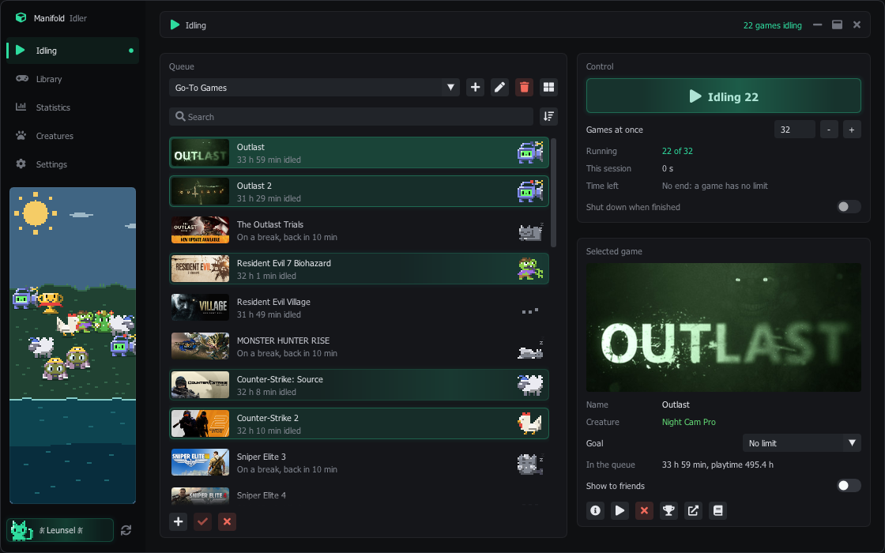
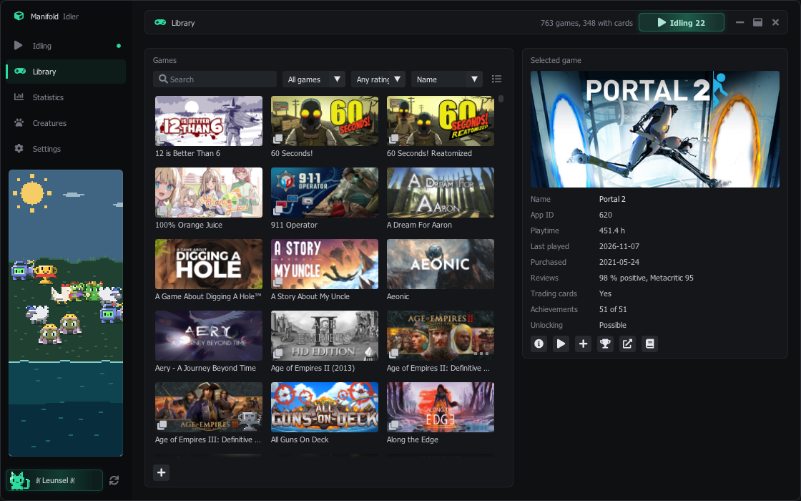
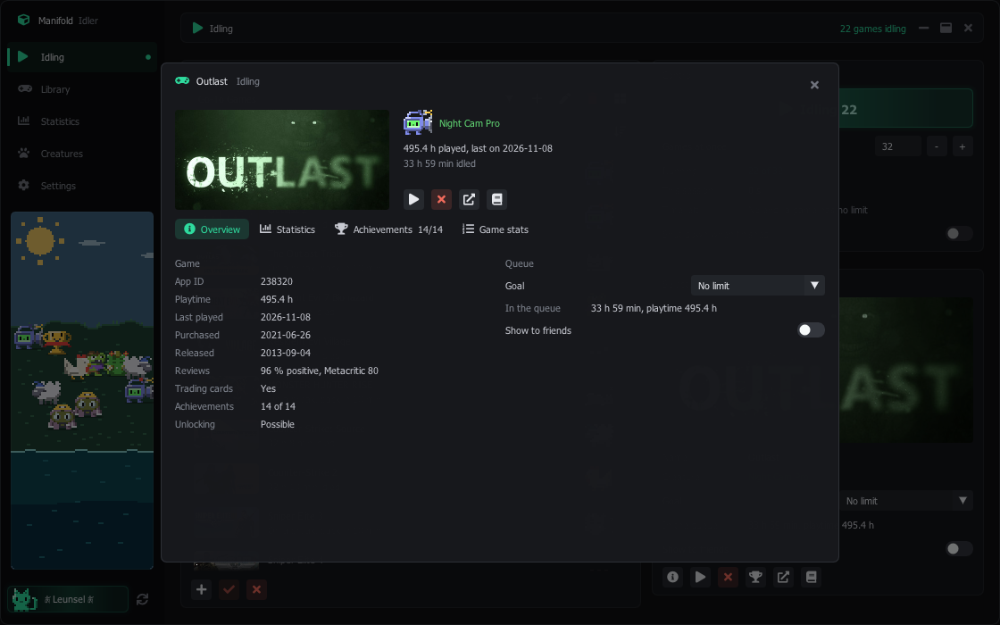
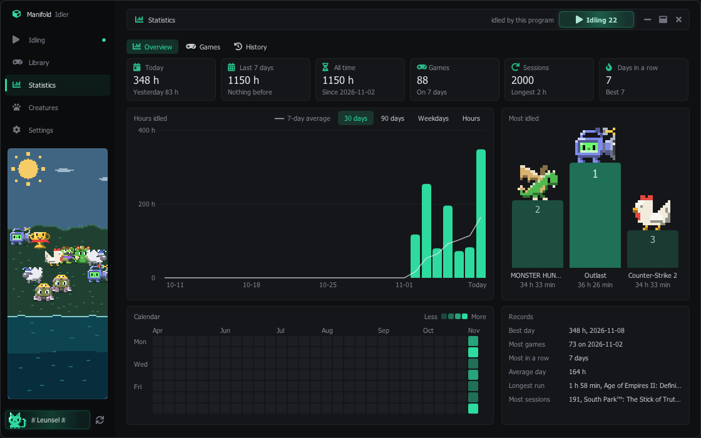
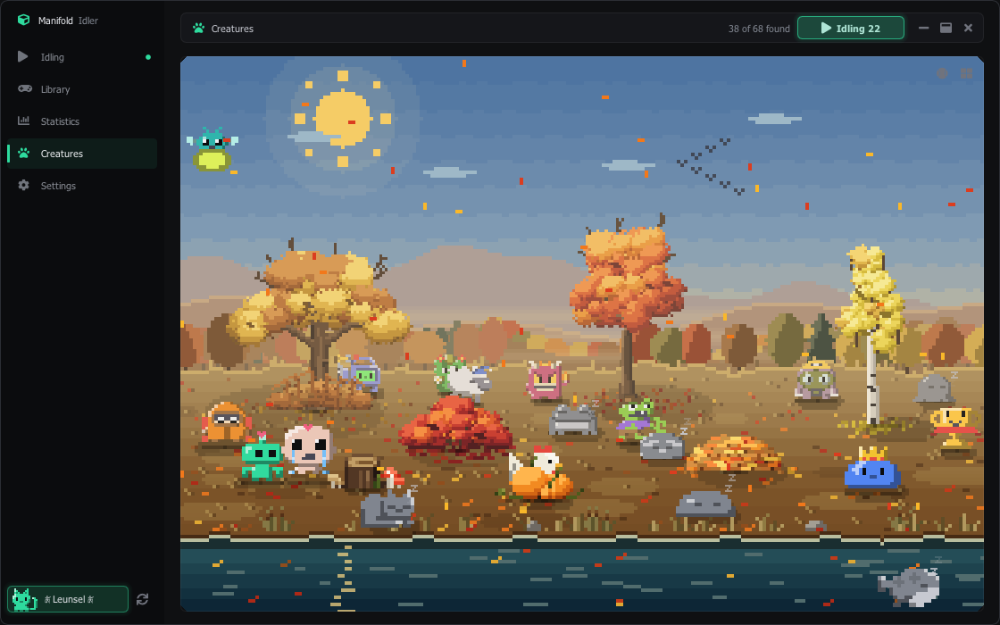
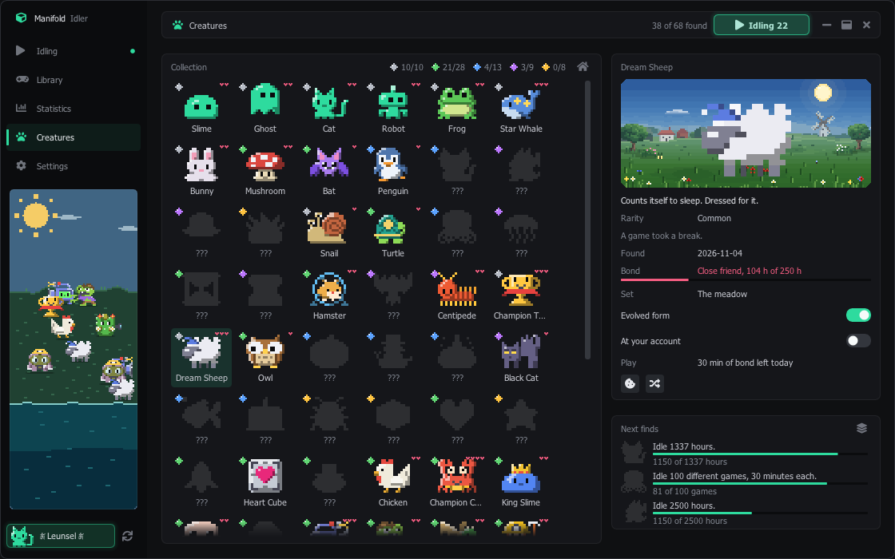
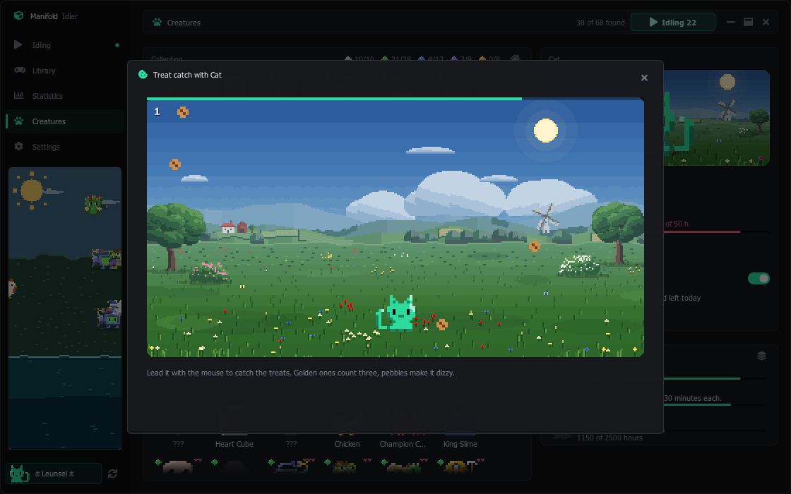

# Manifold Idler

Idles your Steam games through the running Steam client: they count as played without being started. Up to 32 at once,
with saved lists and goals, statistics, achievements and game stats, and 68 pixel creatures that live off the hours.

Windows 10 and 11, 64-bit, and an early version for Linux ([Linux/README.md](Linux/README.md)). The [CLI](CLI/README.md)
runs the same queue without a window, on Windows and Linux.



## Features

### Queue

- Up to 32 games at once, top to bottom. When a game reaches its goal, the next one starts.
- Goals per game: none, idle for a time, or until a total playtime. Time left and the end of the queue are shown.
- Saved lists, each with its own games and progress. A collection from Steam can fill one.
- Drag to reorder, search, sort, pick several with Ctrl or Shift. Removing or sorting can be undone for 10 seconds (Ctrl+Z).
- "Show to friends" makes a game the one Steam shows as played.
- Optional shutdown when the queue is done, after a 60-second countdown that can be called off.
- Space starts and stops, Delete removes what is picked, Ctrl+F searches.

### Library, games, achievements

|  |  |
|---|---|

- Every game of the logged-on account, read from Steam's local files: search, filters, sorting by playtime, reviews,
  Metacritic, release date or achievements, as a list or as covers.
- A double-click opens a game's window: its facts, its place in the queue, its idle time, its achievements and its game stats.
- Achievements: the full list with pictures, unlock or lock one, or "Unlock all" with Undo. Games whose achievements only
  their own server may set are marked and left alone.
- Game stats: set a game's own statistics, within the limits of its schema.
- Reading or changing either starts the game for a moment, unless it is idling already.

### Statistics



- Today, the last 7 days, all time, games, sessions, days in a row.
- Hours per day with a 7-day average, the three most idled games, a calendar of the year, records, time by weekday and hour.
- Every game with its time, sessions and longest session, and one game's last 30 days. The history of each day.

### Creatures



|  |  |
|---|---|

- 68 creatures in five rarities, found by idling: hours, different games, days in a row, certain dates and a few secrets.
- Every idling game shows its creature. They live in the sidebar's terrarium and in a home with four seasons: day while
  games idle, night when none do.
- Pet them, carry and throw them, throw a ball for them to fetch. Each has a character of its own.
- A bond grows with the hours of their games and with every pet. A close friend evolves into a new form.
- Two mini-games for each: one where it lives (Treat catch, Star chase, Pearl dive) and the Shell game. Playing adds bond,
  up to 30 minutes a day.

### Options

- Idle only while you are away, or only at certain hours.
- Pause while you play a game, continue after a restart, keep the computer awake.
- Vary the times: starts up to 10 minutes apart, breaks of 5 to 25 minutes, goals moved by up to 50 %, so games idled
  together do not end with the same hours.
- Protect refunds: a game under 2 hours and within 14 days of purchase stops 10 minutes short of the limit.
- Appear offline to friends while idling.
- Goal for new games, keep running in the tray, start with Windows, season, let angry creatures tug the mouse, log page.

Settings, statistics and the log are kept next to the program: `Manifold-Idler.ini`, `.stats`, `.log`.

### Backups

Each day the program runs, it packs the settings and statistics into a ZIP in `Manifold-Idler.backups` next to them and
keeps the last 7 days. Settings > Backups shows the last one, makes one by hand and opens the folder. "Restore a backup" lists
them with their creatures and hours; the chosen one goes back in place and the program starts again with it. What was there
before goes into a backup of its own first, so a restore can be undone the same way. Each ZIP opens in any ZIP program too.

### Crash reports

When the program crashes, it writes a report into `Manifold-Idler.crashes` next to the settings: a text file that says what
went wrong and where (the stack trace) and, on Windows, a minidump. The same lines go into the log. At the next start a note
says so and the Log tab shows the trace. The last 10 reports are kept. They stay on your computer, but they can hold your Steam
name and the names of your games: look into one before you send it to anyone.

A release build names the program's own code only as `Manifold-Idler.exe+0x...`. Each release has the symbols as
`Manifold-Idler-symbols-windows-x64.zip`: open the `.dmp` with them in Visual Studio or WinDbg, or put `Manifold-Idler.pdb`
next to the program, and its next report names the functions and lines. For Linux, `Manifold-Idler-symbols-linux-x86_64.zip`
holds the program before stripping: `addr2line -f -C -e manifold-idler 0x...` turns an offset into a function.

## Download

The [Releases](../../releases) page has the window program and the CLI for Windows and Linux, and the Sprite Creator for
Windows. Unzip and start; nothing needs installing but SDL3 for the Linux window program (`sudo pacman -S sdl3` on Arch and
CachyOS). Steam has to run, logged on and online; the Sprite Creator does without it.

## How it works

- Every idling game is a small process of its own: the program starts itself again with `--idle=<appid>`, sets
  `SteamAppId`, loads the installed client's `steamclient64.dll` and connects to the logged-on user. Steam counts it as
  that game (`logs\gameprocess_log.txt`: `AppID 480 adding PID ... as a tracked process`).
- No Steamworks SDK: the DLL is the installed client's. No game file is started, opened or changed, and a game does not
  have to be installed.
- Workers end with the window, also after a crash. Only workers load Steam's DLL; each takes about 1 MB while idling.
- The library comes from Steam's local files (`appinfo.vdf`, `localconfig.vdf`, the library cache, the registry) and a
  short ownership check with the client. Only achievement pictures come over the network, from Steam's public image server.
- Time is counted with Windows' own clock, so a speedhack on the program does not add hours.
- The program never sees a password.

## Card farm

Built in, but off in released builds. `Windows/Tools/build-alt.cmd` builds a version with it (`msbuild /p:CardFarm=true`)
into `Build/Windows/Alt`. It signs in through Steam's own page in a WebView2 dialog and keeps no password, cookie or token itself. It reads
the badge pages and farms the games with drops left: those past the warm-up (3 hours) one at a time, the rest together.

## Sprite Creator

`Manifold-Idler-Sprite-Creator.exe` is an editor for the creature pictures, for Windows. It opens the `creatures` folder
next to it, or `Tools/CreatureForge/creatures` when it runs inside a copy of the repository; `--creatures=<folder>` names
another one. Its release zip holds every creature file and [the style guide](Tools/CreatureForge/STYLE.md).

- **Explorer**: every creature and evolved form with its picture and the number of open checks, the scenes to look at it
  in and the light. **+** (Ctrl+N) starts a new creature, from a simple shape or as a copy of the chosen one, or the evolved
  form of a creature that has none yet.
- **Paint**: pencil (B), eraser (E), fill (G), line (L), rectangle (R, Shift for a filled one), picker (I or Alt+click) and
  move (M). The left button paints the first colour of the palette, the right button the second. X paints mirrored, O shows
  the previous frame faintly, H flips the frame, Page Up and Page Down change it.
- **Timeline**: the frames, to add, copy, move or remove and to choose the one it sleeps in, and the steps that play them,
  each with its length, lift, sideways shift and closed eyes. Space plays the loop.
- **Preview**: the creature in the chosen scene and the way the idler shows it in lists, in the collection, asleep, shiny
  and not found yet, next to its other form.
- **Properties**: the three colours, the way it faces, whether it floats, swims or stays in one place, and whether it has
  no eyes on purpose. An evolved form moves like its first form, so those switches follow the first form. Below them are the
  checks of the forge; a click on one that names a frame or a step opens it.

Ctrl+Z and Ctrl+Y undo and redo, Ctrl+S saves the chosen creature. The files are written exactly the way the forge writes
them, so a change shows as a small diff. The idler is built with the pictures: after a change, write the header with
`forge.py header` and build it again. A new creature also needs an entry in `Source/Core/Creatures.h` and a place in the
lists of `forge.py` before the idler shows it.

## Building

The repository holds the programs and the core they share:

| Folder | Program | Built with |
|---|---|---|
| `Windows/` | the window program and the Sprite Creator for Windows (Win32, Direct3D 11, WebView2) | Visual Studio 2022 (v143), `Manifold-Idler.sln`, x64 |
| `Linux/` | the window program for Linux (SDL3, OpenGL 3) | CMake, or Zig from any system: [Linux/README.md](Linux/README.md) |
| `CLI/` | `idler`, without a window, for Windows and Linux | CMake: [CLI/README.md](CLI/README.md) |

- `Source/`: what they share, from the queue and the Steam access to the window programs' pages; `Source/SpriteCreator` is
  the Sprite Creator's screen.
- `Tests/`: the core tests, `Manifold-Idler.Tests` in the solution and `idler_core_tests` in the CLI.
- `Dependencies/`: everything vendored. Dear ImGui 1.92.9b, the SDL3 headers, stb, Microsoft's WebView2 SDK 1.0.4314.35,
  CLI11, and the fonts (Noto Sans, Font Awesome, Press Start 2P, VT323).
- `Docs/`: the error codes, the Linux window program, the web page's themes and the screenshots. `Licenses/`: the licenses of the dependencies. `Tools/`: the creature and
  icon tools.
- `Build/`: everything that is built lands here: `Build/Windows/Release`, `Build/CLI`, `Build/Linux`.

The window program and the CLI share their settings, lists and statistics: on Linux always, on Windows when `idler.exe` lies
next to `Manifold-Idler.exe`. Only one of them runs on a settings file at a time.

GitHub Actions builds the window program for Windows and Linux, the CLI for both and the Sprite Creator on every push, and
runs the tests. A tag `v*` puts the programs on a release.

Creature pictures are JSON files in `Tools/CreatureForge/creatures`, drawn in the [Sprite Creator](#sprite-creator) or by
hand; `Source/UI/CreatureSprites.h` is generated from them, and the core tests fail while it is behind them:

```text
py Tools/CreatureForge/forge.py sheet <key>                          renders out/<key>.png and checks the creature
py Tools/CreatureForge/forge.py contact out/all.png                  all creatures on one picture
py Tools/CreatureForge/forge.py header Source/UI/CreatureSprites.h   writes the header
```

Flags for checking a build next to a running program:

```text
--settings=<file>         another settings file; runs beside the normal program and opens without taking the focus
--capture=<file>          saves the window as a PNG once the library is there, then quits
--page=<name>             idling, library, statistics, creatures, log or settings; --select=<appid> picks a game
--select-also=<ids>       with --select: more queue games picked along with it
--game-window=<tab>       with --select: opens the game's window on overview, statistics, achievements or stats
--pretend-running         the queue's games seem to run, no game starts
--achievements-preview    with --pretend-running: an achievement list from Steam's cached schema; changes go nowhere
--all-creatures           every creature shows as found; nothing of it is saved
--creature=<key>          opens that creature's page
--mini-game=<game>[:play] with --creature: treat, star, pearl or shell; :play starts a round
--home-light=<light>      day, night, dawn or dusk at home and on the stages
--pretend-date=<MM-DD>    today is that day, for the creatures
--pretend-messages        shows the goal and queue-finished messages once
--web-preview             opens Steam's sign-in page in its dialog, for the look; do not sign in there
--fake-shutdown=<file>    writes that file instead of shutting down
--crash-test=<how>        crashes on purpose at the first frame, to check the report: access, abort, terminate, throw,
                          noexcept, stack or thread
--scale=<factor>          overrides the DPI scaling
```

All but `--capture`, `--page`, `--select`, `--scale` and `--fake-shutdown` need `--settings`.

## Error codes

Every error ends in a code such as `MI-1001`. [Docs/ERRORS.md](Docs/ERRORS.md) says for each one what happened and what to
do. In the window, pointing at a message shows the same, and a click copies the code; in a terminal, `idler explain MI-1001`
prints it. Please give the code when you report a problem.

## Disclaimer

- Manifold Idler is not made, endorsed or supported by Valve. Steam is a trademark of Valve Corporation.
- Idling, unlocking achievements and changing game stats happen on your account, and Valve sees them. Steam can restrict an
  account. It did so once, on 2 November 2026, after an earlier login of this program that posed as the Steam mobile app;
  that login is gone.
- The card farm is experimental and off in released builds. Building it in is at your own risk.
- The programs are not signed. Windows SmartScreen warns at the first start ("More info", then "Run anyway").
- You use it at your own risk. The [license](LICENSE) gives it without any warranty.

## License

MIT, see [LICENSE](LICENSE). `Licenses/` has the texts for Dear ImGui, Font Awesome Free, WebView2, SDL3, stb and the
fonts Noto Sans, Press Start 2P and VT323, and `Dependencies/CLI11/LICENSE` the one for CLI11.
